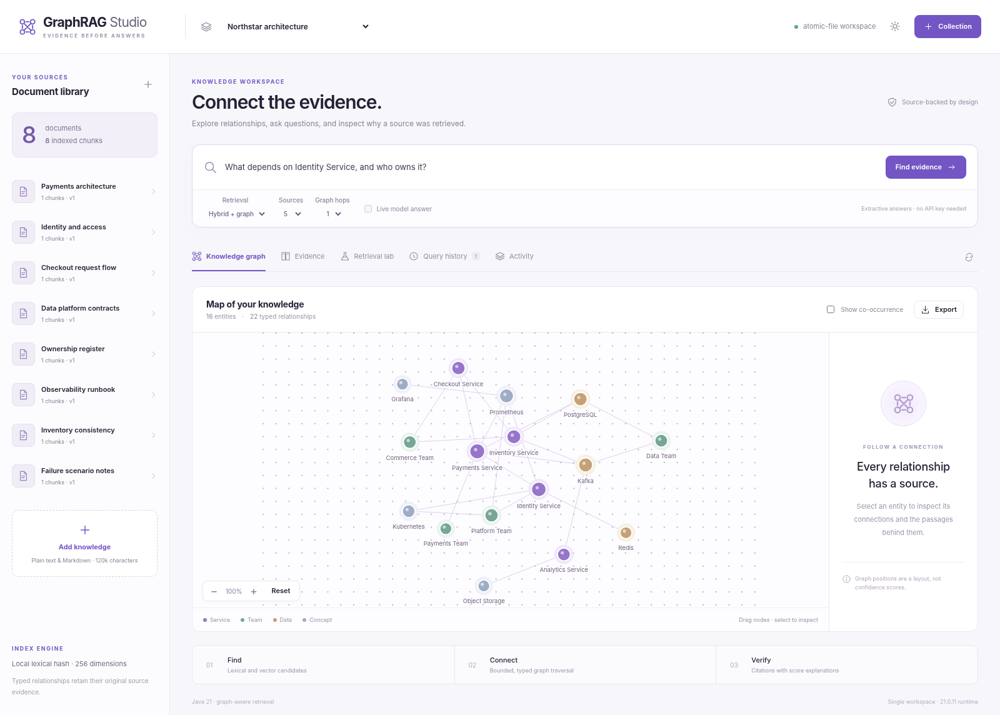

# GraphRAG Studio

**Connect documents without losing the sources behind the connections.**

Java 21 · Spring Boot API adapter · offline JDK launcher · real persistence · browser-native interface



## Why this exists

A relevant sentence does not always contain the full answer. GraphRAG Studio links document evidence through typed relationships, combines lexical and vector candidates, and exposes how each retrieved passage reached the answer context.

## Implemented capabilities

- Collection management, entity aliases, bounded Markdown/text ingestion, content deduplication, and asynchronous reindexing with generation guards.
- Offset-preserving overlapping chunks and per-document index versions; every source passage can be checked against the original text.
- BM25 retrieval, a deterministic lexical-hash vector baseline, optional real Ollama embeddings, and reciprocal-rank fusion.
- Explicit typed triples, separately labelled weak co-occurrence, bounded provenance-bearing graph expansion, and shortest-path exploration through the API.
- A draggable/zoomable SVG graph, source inspectors, citation-backed extractive answers, optional model answers, query history, and feedback revisions.
- Frozen-corpus retrieval ablations with manually labelled relevance, Recall@K/MRR measurements, and JSON/GraphML/Neo4j-Cypher exports.

## Start in one command

Install a **full JDK 21 or newer**, then run from this repository:

```bash
./run.sh
```

Windows PowerShell:

```powershell
.\run.ps1
```

Open **http://localhost:8313**. First startup seeds a fictional example workspace and computes its jobs. No API key, Maven, Node installation, Docker daemon, or paid service is required for this mode. The launcher compiles the actual Java engine; the interface is not a screenshot or hard-coded mock.

The shell/PowerShell scripts read environment variables, **not `.env` files**. Local state is written to `.local/`, which is excluded from Git. One process owns each workspace. Stop with Ctrl+C.

## Spring Boot mode

The Spring MVC adapter calls the **same domain services and security boundary** as the offline launcher. It is not a separate placeholder backend.

```bash
mvn -B -ntp verify
java -jar spring/target/graphrag-studio-spring-0.1.0.jar
```

The Maven build downloads dependencies. Stop the offline launcher first, or choose a different `PORT`. PostgreSQL is available through the JDBC store; a Spring/PostgreSQL deployment is defined in `compose.yaml`:

```bash
python scripts/init_env.py
# Review the newly generated .env before continuing.
docker compose up --build
```

Compose binds the host port to loopback and requires the generated workspace key. Enter `APP_TOKEN` in the interface's connection dialog. See [operations](docs/OPERATIONS.md) before using external providers or changing network exposure.

**Validation boundary:** the Java/JDK application, native tests, browser-module tests, isolated HTTP workflows, and offline DOM rendering were exercised in the delivery environment. Maven/Spring, H2, PostgreSQL, Docker, live Ollama, and live GitHub were not executed there because their required packages/services or network access were unavailable. The repository includes Spring/H2 tests and CI jobs, but does not display a fabricated passing build badge.

## Take the guided demo

1. Open the sample service graph and select a service to inspect relationship provenance.
2. Ask who owns Identity Service and which services depend on it; inspect the cited passages and ranking breakdown.
3. Switch between lexical, vector, and hybrid modes, then run the included relevance benchmark.
4. Add your own Markdown document, reindex it, inspect chunk offsets, and export the resulting graph.

```bash
python scripts/demo.py
```

The CLI stores new example evidence in the selected running workspace. It uses Python's standard library as an HTTP client; the product algorithms remain in Java.

## Tests

```bash
./scripts/check.sh
python scripts/smoke_http.py
```

PowerShell equivalents: `./scripts/check.ps1`, then `python scripts/smoke_http.py`.

The current native suite has **65 passing Java test executions** and **14 passing browser-module tests**. The HTTP smoke starts an isolated JVM and temporary workspace, verifies real HTTP requests, then shuts it down. Tests do not require paid inference. Node 22+ is needed only for browser-module tests; the app itself serves native ES modules.

## Code map

| Path | Responsibility |
|---|---|
| `engine/src/main/java/dev/portfolio/graphrag` | Product algorithms and workflows |
| `engine/src/main/java/dev/portfolio/foundation` | Transactions, queue, HTTP contracts, validation, provider client |
| `spring/` | Spring Boot MVC adapter, Actuator, JDBC dependency, MVC/H2 tests |
| `standalone/` | Dependency-free JDK HTTP adapter and launcher |
| `web/` | Product-specific interface and pure-module tests |
| `tests/` | Executable Java engine and infrastructure contracts |
| `examples/` | Fictional, reproducible input fixtures |
| `scripts/` | Launch checks, real HTTP smoke, CLI demo, environment initialization |
| `docs/` | Architecture, algorithms, API, operations, limitations, demo, roadmap |

## Scope, honestly

The offline hash vectors are lexical features, not learned semantic embeddings. Entity extraction is deterministic and incomplete, not a general language-understanding model. Graph edges are document claims, not verified real-world facts. Retrieval is an in-memory linear scan, not an ANN service. Neo4j is an export target, not the live backing database. Native ingestion supports text/Markdown only; PDF parsing is not implemented.

This is a single-workspace engineering application, not a multi-tenant production SaaS. The initial repository has no claimed development duration, production customers, or fabricated performance improvements. The [12-week roadmap](docs/ROADMAP.md) describes **future work**, not a reconstructed history.

## Engineering documentation

[Architecture](docs/ARCHITECTURE.md) · [Algorithms](docs/ALGORITHMS.md) · [API](docs/API.md) · [Operations](docs/OPERATIONS.md) · [Security](SECURITY.md) · [Testing](docs/TESTING.md) · [Project status](docs/PROJECT_STATUS.md) · [Walkthrough](docs/WALKTHROUGH.md) · [Publishing](docs/PUBLISHING.md)

## License

MIT for this repository's source. Review the licenses of dependencies before redistribution. No dependency source, font files, private tokens, generated runtime database, or artificial Git history is included.

## Pull requests and releases

Changes are checked by GitHub Actions before release. See [the release guide](docs/RELEASING.md) for PR checks, required repository settings, tested container images, and deployment setup.
